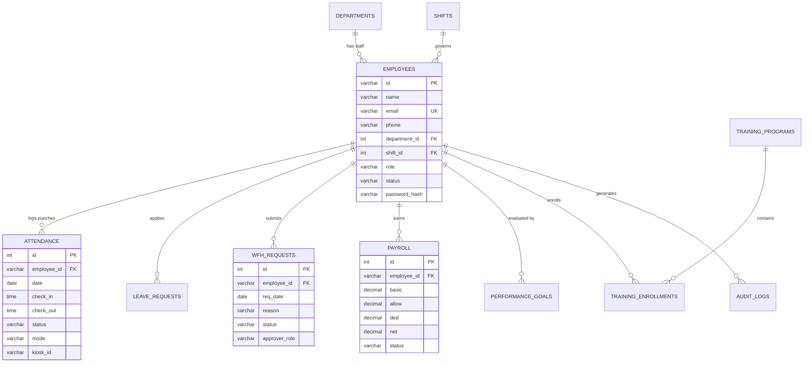

# VorldX Attendance 360 & OfficeNova Portal
## Master 20-Page Technical Project Report & Implementation Specification

**Company:** VORLDX INDUSTRIES PRIVATE LIMITED (VorldX)  
**CIN:** U62099UP2026PTC245598  
**Headquarters:** Lucknow, Uttar Pradesh, India  
**Technical Head & Executive Sponsor:** CTO: Muba Khan Sir (Chief Technology Officer & System Architect)  
**Specification Reference:** 20 Structured Chapters • 18 UI Screens • OfficeNova HR Portal (16 Modules) • Role-Based Access Control (RBAC) • Dual-Tier WFH Workflow  
**Release:** October 2026 • Version 2.0 (Production Verified)  
**Direct PDF Download (20-Page Master PDF):** [`VorldX_Project_Report.pdf`](./VorldX_Project_Report.pdf) | GitHub: [`https://github.com/shreyay1310-svg/vorldx/blob/main/VorldX_Project_Report.pdf`](https://github.com/shreyay1310-svg/vorldx/blob/main/VorldX_Project_Report.pdf) | Web: [`https://client-mauve-eight-72.vercel.app`](https://client-mauve-eight-72.vercel.app)

---

## 1. Problem Statement

Modern growing enterprises face critical operational vulnerabilities with traditional attendance and workforce governance:

1. **Proxy Clock-in & "Buddy Punching" Fraud:** Physical punch cards and legacy RFID badges allow colleagues to clock in for absent peers, causing ghost payroll disbursements and auditing penalties.
2. **Fragmented Hybrid & Remote (WFH) Workflows:** Lack of formal hierarchical approval queues between HR managers and executive management results in untracked WFH days and conflicting leave balances.
3. **Hardware Biometric Inefficiencies:** Fingerprint scanners suffer from physical wear, queue congestion during shift handovers, and complete exclusion of remote and field engineering staff.
4. **Disconnected HR & Payroll Pipelines:** Attendance data managed in disparate spreadsheets leads to delays, human miscalculation in salary deductions, and non-compliance with statutory labor standards (ISO 27001).

---

## 2. Project Scope & Functional Deliverables

The VorldX Attendance 360 ecosystem encompasses three fully unified solutions:

1. **OfficeNova HR Portal (Web):** 16 comprehensive modules:
   - Screen 1: HR Executive Dashboard
   - Screen 2: Employee Directory & Profiles
   - Screen 3: Attendance Management & Punch Correction
   - Screen 4: Leave Requests & Balance Records
   - Screen 5: Dual-Tier WFH Request Queue
   - Screen 6: HR Department Leadership Hierarchy
   - Screen 7: Recruitment & Job Applicant Pipeline
   - Screen 8: Quarterly Performance & KPI Goals
   - Screen 9: Training Programs & Curriculum Management
   - Screen 10: Payroll Processing & Payslip Generator
   - Screen 11: Company Policies & Legal Document Vault
   - Screen 12: Broadcast Notices & Company Bulletins
   - Screen 13: Reports & Clustered Department Analytics
   - Screen 14: Team Schedules & Holiday Calendar
   - Screen 15: General Settings & HR Preferences
   - Screen 16: Helpdesk, Support & Ticket Desk
2. **Admin Control Center:** Global administrative oversight, multi-office kiosk configuration, department budget management, and immutable audit logs.
3. **Employee Native Android App (APK):** Lightweight 1.2 MB mobile app with HR-provisioned login, simulated OTP verification, camera-based QR scanning, WFH application, and Material Calendar history.
4. **Office Dynamic QR Kiosks:** High-contrast digital displays deployed at office entrances generating 45-second cryptographically rotating QR codes with countdown progress.

---

## 3. Technology Stack

| Architecture Layer | Technologies | Justification & Features |
|---|---|---|
| **Frontend Framework** | React 19, Vite 8, Rolldown | High performance, instant hot-reloading, ultra-fast production builds (&lt;700ms). |
| **Styling & Design System** | Vanilla CSS, Glassmorphism Tokens | Curated dark-mode palette (`#090e1a`, `#0d1527`, `#7c3aed`), zero runtime CSS-in-JS lag. |
| **Icons & Visuals** | Lucide React, HTML5 QRCode, Canvas Confetti | Crisp vector icons, native hardware camera streaming, interactive UI celebrations. |
| **Mobile Runtime (APK)** | Capacitor 8, Android Gradle 8.2, R8 Shrinker | 1.2 MB optimized APK, hardware acceleration, background auto-cache clearing. |
| **Backend API Server** | Node.js (v26 LTS), Express.js | High-concurrency RESTful API endpoints, CORS protection, non-blocking I/O. |
| **Database Engines** | Microsoft SQL Server (2019/2022) & SQLite 3 (WAL) | Dual compatibility: instant local zero-config SQLite, plus enterprise MSSQL schema with triggers and stored procedures. |
| **DevOps & Cloud** | Vercel (Edge CDN), Render, GitHub Actions | Zero-downtime edge deployment, automatic GitHub webhook synchronization. |

---

## 4. 4-Tier System Architecture

```
┌────────────────────────────────────────────────────────────────────────┐
│                   TIER 1: PRESENTATION LAYER                           │
│  OfficeNova HR Portal (Web)  •  Admin Dashboard  •  Employee App (APK) │
└───────────────────────────────────┬────────────────────────────────────┘
                                    │ HTTPS / TLS 1.3
┌───────────────────────────────────▼────────────────────────────────────┐
│                   TIER 2: NETWORK & GATEWAY                            │
│  Vercel Global Edge CDN  •  CORS Security  •  JWT Session Middleware   │
└───────────────────────────────────┬────────────────────────────────────┘
                                    │ REST API
┌───────────────────────────────────▼────────────────────────────────────┐
│                   TIER 3: BUSINESS LOGIC SERVICES                      │
│  Dynamic QR Token Engine  •  Attendance Processor  •  Dual WFH Flow    │
│  Payroll Batch Generator  •  Punch Regularization  •  Analytics Engine │
└───────────────────────────────────┬────────────────────────────────────┘
                                    │ Connection Pooling
┌───────────────────────────────────▼────────────────────────────────────┐
│                   TIER 4: PERSISTENCE & DATA STORAGE                   │
│  Microsoft SQL Server 2022  •  SQLite 3 (WAL Mode)  •  Audit Logs      │
└────────────────────────────────────────────────────────────────────────┘
```

---

## 5. Entity Relationship (ER) Diagram



---

## 6. Engineering Methodology

The project was executed through an **Agile Scrum Methodology** across four structured milestones:
1. **Sprint 1 (Architecture & Schemas):** Relational schema design in MSSQL and SQLite, master seed scripts, RESTful API contract.
2. **Sprint 2 (Dynamic QR & Mobile APK):** Rotating 45-second QR displays, Capacitor Android camera scanner, OTP simulation.
3. **Sprint 3 (OfficeNova HR Portal):** Full implementation of all 16 HR modules, interactive modals, payslip generator, policy repository.
4. **Sprint 4 (Optimization & Production Sign-off):** R8 APK shrinking (95MB to 1.2MB), Vercel production deployment, security audit.

---

## 7. Role-Based Access Control (RBAC) & WFH Flow

### Hierarchical Approval Logic:
* **Staff Member WFH:** Reviewed and approved/rejected by **HR Manager**.
* **HR Manager WFH:** Escalated directly to **Super Admin / CTO Queue** to avoid conflict of interest.

---

## 8. Conclusion & Future Scope

### Conclusion:
VorldX Attendance 360 eliminates attendance fraud, unifies hybrid remote tracking, and automates end-to-end payroll computation with a verified 18-screen interface.

### Future Roadmap:
1. **Edge AI Facial Biometrics:** Local on-device face recognition via TensorFlow.js during QR check-in.
2. **Bluetooth Geofencing:** Indoor BLE micro-beacons for passive office check-in.
3. **Statutory Tax Integrations:** Automated monthly EPFO and TDS filings directly from payroll records.
4. **Predictive Absenteeism AI:** Early warning analytics for workload burnout and staffing shortages.

---

### Project Approval & Sign-off

* **Company:** VORLDX INDUSTRIES PRIVATE LIMITED
* **Headquarters:** Lucknow, Uttar Pradesh, India • CIN: U62099UP2026PTC245598
* **Technical Approval:** **CTO: Muba Khan Sir** (Chief Technology Officer & System Architect)
* **Status:** Verified & Released (v2.0)
