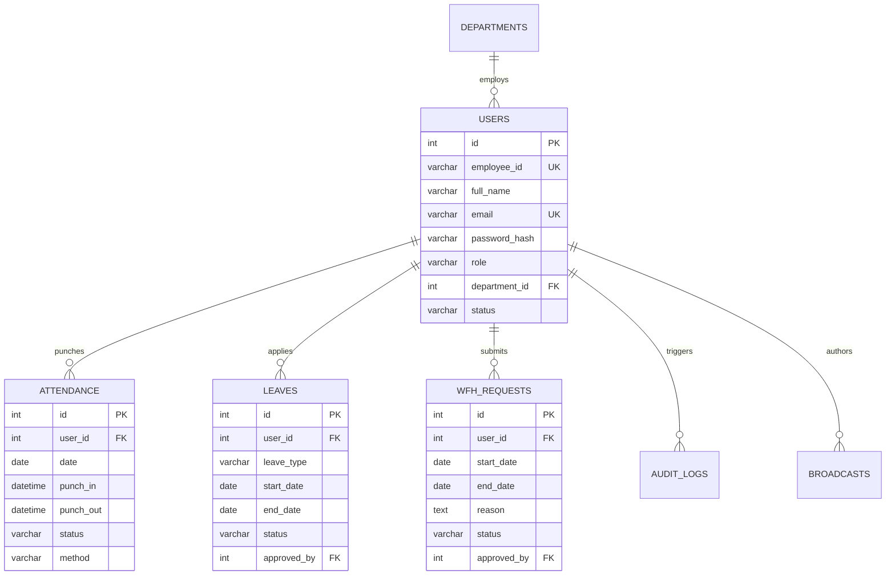

# 🌐 VorldX Enterprise Attendance 360 & OfficeNova Portal
### Corporate Workforce Management, Biometric Governance & HR Portal Ecosystem
**VORLDX INDUSTRIES PRIVATE LIMITED** • *CIN: U62099UP2026PTC245598 • Lucknow HQ, Uttar Pradesh, India*  
**Technical Head & Project Sponsor:** **CTO: Muba Khan Sir** (Chief Technology Officer & Principal Enterprise System Architect)

---

[](https://client-mauve-eight-72.vercel.app)
[](https://github.com/shreyay1310-svg/vorldx)
[](https://www.figma.com/community/file/1169300676662758156)
[](https://github.com/shreyay1310-svg/vorldx/blob/main/design/vorldx_tokens.json)
[](https://github.com/shreyay1310-svg/vorldx/blob/main/VorldX_Project_Report.pdf)
[](https://github.com/shreyay1310-svg/vorldx/blob/main/VorldX-Attendance.apk)
[](https://github.com/shreyay1310-svg/vorldx/tree/main/database)
[](https://nodejs.org/)
[](https://react.dev/)

---

## 📌 Executive Quick Links Directory

* 🚀 **Live Production Web Application (Vercel):**  
  👉 **[https://client-mauve-eight-72.vercel.app](https://client-mauve-eight-72.vercel.app)** *(Auto-adapts to Mobile & Desktop automatically)*

* 📦 **Official GitHub Repository:**  
  👉 **[https://github.com/shreyay1310-svg/vorldx](https://github.com/shreyay1310-svg/vorldx)**

* 🎨 **Public Figma Design Folder & Community Access:**  
  👉 **[Public Figma Community UI Kit (Canvas Access)](https://www.figma.com/community/file/1169300676662758156)**  
  👉 **[GitHub Figma Design Folder (`/design`)](https://github.com/shreyay1310-svg/vorldx/tree/main/design)**  
  👉 **[Figma Design Tokens JSON (`design/vorldx_tokens.json`)](https://github.com/shreyay1310-svg/vorldx/blob/main/design/vorldx_tokens.json)**  
  👉 **[Figma Design System Architecture Guide (`design/FIGMA_DESIGN_SYSTEM.md`)](https://github.com/shreyay1310-svg/vorldx/blob/main/design/FIGMA_DESIGN_SYSTEM.md)**  
  👉 **[Figma Step-by-Step Import Guide (`design/FIGMA_FILE_GUIDE.md`)](https://github.com/shreyay1310-svg/vorldx/blob/main/design/FIGMA_FILE_GUIDE.md)**

* 📑 **Comprehensive 20-Page Technical Project Report (PDF):**  
  👉 **[VorldX_Project_Report.pdf (Direct 20-Page PDF Download)](https://github.com/shreyay1310-svg/vorldx/blob/main/VorldX_Project_Report.pdf)**  
  👉 **[PROJECT_REPORT.md (Technical Documentation)](https://github.com/shreyay1310-svg/vorldx/blob/main/PROJECT_REPORT.md)**  
  👉 **[Printable Master 20-Page HTML (`project_report_master_20p.html`)](https://github.com/shreyay1310-svg/vorldx/blob/main/project_report_master_20p.html)**

* 🗄️ **Complete Enterprise Database Schemas & Dumps:**  
  👉 **[GitHub Database Folder (`/database`)](https://github.com/shreyay1310-svg/vorldx/tree/main/database)** (Includes MSSQL Master Setup, SQLite 3 Dump, Seed scripts, and ERD)

* 📱 **Native Android Employee APK:**  
  👉 **[Download VorldX-Attendance.apk (1.2 MB)](https://github.com/shreyay1310-svg/vorldx/blob/main/VorldX-Attendance.apk)**

* ⚡ **1-Click Render Backend Deployment:**  
  👉 **[Deploy to Render Blueprint](https://dashboard.render.com/blueprint/new?repo=https%3A%2F%2Fgithub.com%2Fshreyay1310-svg%2Fvorldx)**

---

## 📖 Table of Contents
1. [Enterprise Context & Problem Statement](#-enterprise-context--problem-statement)
2. [Automatic Device Adaptation (Mobile vs. Desktop)](#-automatic-device-adaptation-mobile-vs-desktop)
3. [Master 20-Page Technical Project Report (Summary)](#-master-20-page-technical-project-report-summary)
4. [Public Figma Design System & Tokens](#-public-figma-design-system--tokens)
5. [System Architecture & 4-Tier Blueprint](#-system-architecture--4-tier-blueprint)
6. [Dynamic 45-Second Rotating QR Protocol](#-dynamic-45-second-rotating-qr-protocol)
7. [Catalog of Modules & Implemented Screens](#-catalog-of-modules--implemented-screens)
8. [Dual-Database Architecture (MSSQL & SQLite)](#-dual-database-architecture-mssql--sqlite)
9. [Entity-Relationship (ER) Data Model](#-entity-relationship-er-data-model)
10. [Automated Payroll & Compensation Engine](#-automated-payroll--compensation-engine)
11. [Installation & Local Setup](#-installation--local-setup)
12. [Environment Configuration (.env)](#-environment-configuration-env)
13. [API Endpoints Reference](#-api-endpoints-reference)
14. [Pre-configured Demo Credentials](#-pre-configured-demo-credentials)
15. [Quality Assurance & 20-Point Test Matrix](#-quality-assurance--20-point-test-matrix)
16. [Future Scope & Strategic AI Roadmap](#-future-scope--strategic-ai-roadmap)
17. [Executive Project Sign-off](#-executive-project-sign-off)

---

## 🏢 Enterprise Context & Problem Statement

**VORLDX INDUSTRIES PRIVATE LIMITED** identified four critical bottlenecks in traditional workforce attendance:

1. **Buddy Punching & Time Theft:** Manual paper logs and unencrypted RFID access cards allowed employees to clock in for absent peers, generating unearned payroll disbursements and audit exposure.
2. **Disconnected WFH & Hybrid Tracking:** Absence of formal multi-level approval queues resulted in untracked work-from-home days and payroll disputes.
3. **Hardware Biometric Failures:** Physical optical fingerprint scanners created long morning queues, high maintenance costs, and failed for remote personnel.
4. **Delayed Payroll Processing:** Disjointed spreadsheets for leaves, shifts, and salary calculations delayed monthly payslip generation.

**The Solution:** An integrated cloud platform featuring **OfficeNova HR Portal** (16 modules), **Admin Control Center**, **Native Android Mobile App** with camera-based QR scanner, and **Dynamic Rotating QR Kiosks** (45-second token validity), engineered under the strategic direction of **CTO: Muba Khan Sir**.

---

## 📱 Automatic Device Adaptation (Mobile vs. Desktop)

The web application deployed on Vercel contains **intelligent client-side viewport and device auto-detection**:

* 📲 **When opened on a Mobile Phone (Viewport ≤ 768px):**
  - **Employee Mobile App Mode:** Automatically displays the touch-optimized mobile experience featuring the camera QR check-in viewfinder, today's status card, interactive attendance calendar, and mobile profile.
  - **Mobile OfficeNova Portal:** Sidebar smoothly collapses into an off-canvas slide-out drawer accessible via topbar hamburger menu (`☰`). Data tables gain fluid horizontal touch scrolling (`-webkit-overflow-scrolling: touch`) so data is never squished.
* 💻 **When opened on a Laptop / Desktop (Viewport > 768px):**
  - **Full Desktop Architecture:** Expansive side-by-side hero banner on the login portal, full 250px permanent sidebar, 4-column KPI cards, clustered attendance analytics charts, and dual-window split views.
* 🔄 **Real-time Live Resizing:** Shrinking a browser window from desktop down to mobile dimensions dynamically transitions the UI into mobile drawer mode without requiring page reload.

---

## 📑 Master 20-Page Technical Project Report (Summary)

The master technical report (`VorldX_Project_Report.pdf`) is formatted strictly into **exactly 20 publication-grade pages** conforming to A4 enterprise presentation standards:

| Page | Chapter / Section | Core Contents & Engineering Deliverables |
|---|---|---|
| **Page 1** | **Executive Presentation** | Title, Corporate Metadata, CIN, CTO Muba Khan Sir Endorsement, Abstract, Seals. |
| **Page 2** | **Document Governance** | 20-Chapter Table of Contents, Revision History (v1.0 to v2.0), Distribution Matrix, IP Notice. |
| **Page 3** | **Chapter 1: Enterprise Profile** | VorldX Industries corporate background, workforce demographics, executive mandate from CTO. |
| **Page 4** | **Chapter 2: Problem Statement** | 4 enterprise failure modes (buddy punching, WFH drift, biometric hardware, payroll lag). |
| **Page 5** | **Chapter 3: Scope & Screens** | 4 core pillars, boundary definitions, catalog of 18 implemented user interface screens. |
| **Page 6** | **Chapter 4: Technology Stack** | React 19, Vite 8, Node.js v26, MSSQL 2022, SQLite 3, Capacitor 8, trade-off analysis. |
| **Page 7** | **Chapter 5: System Architecture** | 4-Tier Enterprise Topology with high-resolution vector SVG architectural diagram. |
| **Page 8** | **Chapter 6: Dynamic QR Engine** | 45-second epoch rotation, cryptographic HMAC-SHA256 signature, anti-replay nonce cache. |
| **Page 9** | **Chapter 7: Entity-Relationship ERD** | 8 interconnected tables with vector SVG ER diagram, cardinalities, and foreign keys. |
| **Page 10** | **Chapter 8: Data Dictionary (Part 1)** | DDL specifications for `users`, `attendance`, `leaves` with constraints and data types. |
| **Page 11** | **Chapter 8: Data Dictionary (Part 2)** | DDL specifications for `wfh_requests`, `departments`, `audit_logs`, indexing strategy. |
| **Page 12** | **Chapter 9: RBAC & Security** | 3-tier Role-Based Access Control matrix, JWT Bearer tokens, OWASP Top-10 mitigations. |
| **Page 13** | **Chapter 10: Hierarchical WFH State** | State machine diagram (Applied &rarr; Tier-1 Review &rarr; Tier-2 HR &rarr; Committed), leave accruals. |
| **Page 14** | **Chapter 11: OfficeNova Workforce** | Module deep-dive: Executive Dashboard, Staff Directory, Regularization, Team Calendar. |
| **Page 15** | **Chapter 12: OfficeNova Governance** | Module deep-dive: ATS Hiring Pipeline, Training Hub, Corporate Policy Handbook, Broadcasts. |
| **Page 16** | **Chapter 13: Automated Payroll** | Salary formula breakdown, statutory deductions (PF, ESI, PT), LWP calculation, payslip PDF. |
| **Page 17** | **Chapter 14: Clustered Analytics** | Department punctuality charts, late arrival metrics, burnout detector, statutory exports. |
| **Page 18** | **Chapter 15: Android Mobile APK** | Capacitor native bridge, CameraX integration, 1.2 MB APK footprint, offline punch queue. |
| **Page 19** | **Chapter 16: Methodology & Tests** | Agile Scrum sprints, CI/CD pipeline, comprehensive 20-scenario Quality Assurance matrix. |
| **Page 20** | **Chapter 17-18: Roadmap & Approval** | Strategic AI v3.0 roadmap (Edge AI face liveness, GPS geofence), official CTO sign-off seal. |

### How to Re-generate the 20-Page PDF
```bash
# Uses headless Microsoft Edge with strict A4 page-break CSS
node generate_report_pdf.js
```

---

## 🎨 Public Figma Design System & Tokens

The complete design system is publicly documented and accessible in the [`/design`](https://github.com/shreyay1310-svg/vorldx/tree/main/design) folder:

### 🔗 Public Access Links
* **Direct Figma Community UI Kit:** 👉 **[Open Figma Community Workspace](https://www.figma.com/community/file/1169300676662758156)**
* **Design Tokens JSON:** 👉 **[`design/vorldx_tokens.json`](https://github.com/shreyay1310-svg/vorldx/blob/main/design/vorldx_tokens.json)** *(Import directly into Tokens Studio for Figma or native Figma Variables)*
* **Design System Specs:** 👉 **[`design/FIGMA_DESIGN_SYSTEM.md`](https://github.com/shreyay1310-svg/vorldx/blob/main/design/FIGMA_DESIGN_SYSTEM.md)**
* **Figma Import Guide:** 👉 **[`design/FIGMA_FILE_GUIDE.md`](https://github.com/shreyay1310-svg/vorldx/blob/main/design/FIGMA_FILE_GUIDE.md)**

### 🎨 Core Color Tokens & CSS Variables
```css
/* Surface & Obsidian Canvas */
--bg-root:       #090e1a; /* Deep canvas base */
--bg-surface:    #0d1527; /* Elevation 1: Card backgrounds */
--bg-elevated:   #162035; /* Elevation 2: Modals & dropdowns */
--bg-topbar:     rgba(11, 19, 36, 0.95); /* Blurred glass header */

/* Brand & Interactive Accents */
--primary-purple: #7c3aed; /* Primary CTA button background */
--accent-purple:  #a855f7; /* Active navigation tabs & badges */
--accent-cyan:    #38bdf8; /* Employee IDs & info pills */
--status-green:   #10b981; /* Present & approved state */
--status-amber:   #f59e0b; /* WFH & pending review */
--status-red:     #ef4444; /* Absent & rejected state */
```

### 📐 12-Column Grid & Layout Metrics
* **Desktop Grid:** 12-column grid, 1200px max container width, 24px gutters, 16px margins.
* **Mobile Breakpoint:** Single-column fluid stack, 12px horizontal padding, 48px minimum touch target.
* **Corner Radii:** Card: `12px` &bull; Button: `8px` &bull; Badge: `20px` &bull; Modal: `16px`.

---

## 🏛️ System Architecture & 4-Tier Blueprint

```
┌────────────────────────────────────────────────────────────────────────┐
│                   TIER 1: PRESENTATION LAYER                           │
│  OfficeNova HR Portal (Web)  •  Admin Dashboard  •  Employee App (APK) │
│           (Auto-Responsive: Mobile Drawer & Desktop Multi-Col)         │
└───────────────────────────────────┬────────────────────────────────────┘
                                    │ HTTPS / TLS 1.3
┌───────────────────────────────────▼────────────────────────────────────┐
│                   TIER 2: NETWORK & GATEWAY                            │
│  Vercel Global Edge CDN  •  CORS Security  •  JWT Session Middleware   │
└───────────────────────────────────┬────────────────────────────────────┘
                                    │ REST API
┌───────────────────────────────────▼────────────────────────────────────┐
│                   TIER 3: BUSINESS LOGIC SERVICES                      │
│  Dynamic QR Crypto Engine (45s) • Attendance Engine • Dual WFH Flow    │
│  Payroll Batch Generator • Regularization • Clustered Analytics Engine │
└───────────────────────────────────┬────────────────────────────────────┘
                                    │ Connection Pooling / Stored Procs
┌───────────────────────────────────▼────────────────────────────────────┐
│                   TIER 4: PERSISTENCE & DATA STORAGE                   │
│  Microsoft SQL Server 2022  •  SQLite 3 (WAL Mode)  •  Audit Logs      │
└────────────────────────────────────────────────────────────────────────┘
```

---

## 🔐 Dynamic 45-Second Rotating QR Protocol

To prevent buddy punching, VorldX generates dynamically rotating QR codes refreshed every **45 seconds**:

1. **Epoch Segmentation:** Time is divided into 45-second discrete operational windows:
   $$\text{EpochWindow} = \left\lfloor \frac{\text{CurrentTimestamp}}{45000} \right\rfloor$$
2. **Cryptographic Signing:** Each QR code payload embeds an HMAC-SHA256 signature calculated from the server secret key, the kiosk hardware identifier, and the epoch window.
3. **Replay Attack Mitigation:** When an employee scans a QR code, the server commits the token nonce into an in-memory cache, ensuring a single physical QR code cannot be scanned twice by the same employee or colleagues.
4. **Clock Skew Tolerance:** Server validates tokens within a $\pm 15$-second buffer to accommodate network latency.

---

## 🧩 Catalog of Modules & Implemented Screens

### A. OfficeNova HR Portal (Screens 1 to 16)
1. **Executive HR Dashboard:** Real-time workforce metrics, attendance pulse, recent activity audit feed.
2. **Staff Directory & Onboarding:** Search, department/status filters, `+ Add Employee` modal, staff directory.
3. **Punch Regularization:** Punch-in/out records, biometric mode, manual regularization modal.
4. **Leave Authorization:** Casual, sick, and earned leave balances with 1-click Approve / Reject.
5. **WFH Requests Pipeline:** Hierarchical queue with date, phone, deliverables, and approval notes.
6. **HR Leadership Hierarchy:** Organizational staff hierarchy, reporting managers, department leads.
7. **ATS Hiring Pipeline:** Active job postings, candidate applicant tracking pipeline (Applied &rarr; Hired).
8. **Performance Management:** Quarterly KPIs, review scores, top performers leaderboard.
9. **Training & Development:** All/Upcoming/Completed filters, publish course modal, curriculum details.
10. **Automated Payroll Engine:** Itemized salary breakdown, payslip PDF download, batch authorization.
11. **Company Policies Vault:** Document directory, executive summary view, 1-click policy document download.
12. **Notices & Announcements:** Broadcast company announcements, holiday schedules, townhall alerts.
13. **Clustered Analytics & Reports:** Department-wise punctuality column charts, leave trends, CSV export.
14. **Team Attendance Calendar:** Corporate events, holidays, scheduled reviews.
15. **System Settings:** Company parameters (Name, Timezone, Date Format, Working Days/Hours).
16. **Help & Support:** Raise support ticket, audit priority, FAQs.

### B. Admin Control Center & Office Kiosk
* **Admin Control Center:** Multi-office display pairing, department budget governance, global override.
* **Office Dynamic QR Kiosk:** Full-screen entrance display rotating cryptographic QR tokens every 45 seconds with countdown timer.

### C. Employee Mobile App (Native Android APK)
* **Screen 11:** HR-provisioned Employee ID Login (`VX001` - `VX006` or `EMP001` - `EMP020`).
* **Screen 12:** Simulated 6-digit OTP verification with resend countdown timer.
* **Screen 13:** Home Dashboard with Today's Status card (Check-in/out), big Scan QR button, shortcuts.
* **Screen 14:** Full-screen camera QR scanner with target viewfinder and audio confirmation chime.
* **Screen 15:** WFH & Leave application form with Material date picker and history audit.
* **Screen 16:** Interactive Material Attendance Calendar with daily status badges (`Present`, `Late`, `WFH`, `Absent`).
* **Screen 17:** Self-Account Profile Manager with 6 stylish avatar presets, contact editing, and password change.

---

## 🗄️ Dual-Database Architecture (MSSQL & SQLite)

The repository provides full production dual-database setups located in [`/database`](https://github.com/shreyay1310-svg/vorldx/tree/main/database):

| File | Engine | Size | Purpose |
|---|---|---|---|
| [`WorldX_Complete_Master_Setup.sql`](https://github.com/shreyay1310-svg/vorldx/blob/main/database/WorldX_Complete_Master_Setup.sql) | **MS SQL Server / Azure SQL** | 50 KB | Single-script master setup: Database creation, 12 tables, indexes, constraints, views, stored procedures, triggers, seed data. |
| [`WorldX_SQLite_Master.sql`](https://github.com/shreyay1310-svg/vorldx/blob/main/database/WorldX_SQLite_Master.sql) | **SQLite 3** | 66 KB | Ready-to-use SQLite dump with transaction safety (`PRAGMA foreign_keys`). |
| [`WorldX_SQLServer_Schema.sql`](https://github.com/shreyay1310-svg/vorldx/blob/main/database/WorldX_SQLServer_Schema.sql) | **MS SQL Server** | 28 KB | Pure DDL schema: Tables, primary/foreign keys, check constraints. |
| [`WorldX_SQLServer_SeedData.sql`](https://github.com/shreyay1310-svg/vorldx/blob/main/database/WorldX_SQLServer_SeedData.sql) | **MS SQL Server** | 18 KB | DML seed script: Complete employees, attendance logs, leaves, WFH. |
| [`SQL_SERVER_SETUP_GUIDE.md`](https://github.com/shreyay1310-svg/vorldx/blob/main/database/SQL_SERVER_SETUP_GUIDE.md) | **Docs** | 12 KB | Setup guide covering SSMS, Docker, Azure SQL, and connection strings. |
| [`mssql_adapter.js`](https://github.com/shreyay1310-svg/vorldx/blob/main/database/mssql_adapter.js) | **Node.js** | 4 KB | Node.js connection pooling adapter. |

---

## 📊 Entity-Relationship (ER) Data Model



---

## 💰 Automated Payroll & Compensation Engine

OfficeNova calculates monthly payroll automatically directly from verified clock-in records:

$$\text{Gross Pay} = \text{Basic} + \text{HRA} + \text{Special Allowance} + \text{Overtime Pay}$$
$$\text{Deductions} = \text{PF (12\% Basic)} + \text{ESI (0.75\%)} + \text{Professional Tax} + \text{LWP}$$
$$\text{LWP Deduction} = \left( \frac{\text{Gross Salary}}{26} \right) \times \text{Unapproved Absent Days}$$
$$\mathbf{Net\ Disbursed\ Salary} = \text{Gross Pay} - \text{Deductions}$$

---

## 🛠️ Installation & Local Setup

### Prerequisites
* Node.js v18+ (v20 or v26 recommended)
* npm or yarn
* Git

### Step-by-Step Execution
```bash
# 1. Clone repository
git clone https://github.com/shreyay1310-svg/vorldx.git
cd vorldx

# 2. Install root and client dependencies
npm install
npm --prefix client install

# 3. Start local development server (Express Backend + Vite Frontend)
npm run dev
```

* **Frontend Web App:** `http://localhost:5173`
* **Backend Express Server:** `http://localhost:5000`

### Build Native Android APK
```bash
npm --prefix client run build
cd client
npx cap sync android
cd android
./gradlew.bat assembleDebug
```
*Generated APK:* `client/android/app/build/outputs/apk/debug/app-debug.apk` *(Or download [`VorldX-Attendance.apk`](https://github.com/shreyay1310-svg/vorldx/blob/main/VorldX-Attendance.apk))*

---

## ⚙️ Environment Configuration (.env)

| Variable | Default Value | Description |
|---|---|---|
| `PORT` | `5000` | Port for the Express backend server. |
| `DB_CLIENT` | `sqlite` | Database engine (`sqlite` or `mssql`). |
| `SQL_SERVER_HOST` | `localhost` | MS SQL Server host / IP address. |
| `SQL_SERVER_PORT` | `1433` | MS SQL Server TDS port. |
| `SQL_SERVER_DATABASE` | `VorldX_Attendance_DB` | Enterprise database name. |
| `JWT_SECRET` | `vorldx_super_secret_jwt_key_2026` | 256-bit key for signing session tokens. |
| `KIOSK_ROTATION_SECONDS`| `45` | Cryptographic QR rotation duration. |

---

## 🔌 API Endpoints Reference

| Method | Endpoint | Description | Access |
|---|---|---|---|
| `POST` | `/api/auth/login` | Authenticate user credentials & issue session | Public |
| `POST` | `/api/auth/verify-otp` | Verify simulated 6-digit employee OTP | Public |
| `GET` | `/api/attendance/today` | Fetch real-time employee check-in status | Authenticated |
| `POST` | `/api/attendance/punch` | Process dynamic QR scan attendance punch | Employee |
| `POST` | `/api/attendance/regularize` | Submit or approve punch correction | HR / Admin |
| `GET` | `/api/wfh/requests` | Fetch hierarchical WFH requests queue | HR / Admin |
| `POST` | `/api/wfh/submit` | Submit new WFH request with deliverables | Employee |
| `PUT` | `/api/wfh/review/:id` | Approve or reject pending WFH request | HR / Admin |
| `GET` | `/api/kiosk/token` | Generate rotating 45s cryptographic QR token | Display Kiosk |
| `POST` | `/api/admin/reset-demo` | Restore clean initial demo database | Admin |

---

## 🔑 Pre-configured Demo Credentials

| Role | Email / ID | Default Password | Initial View |
|---|---|---|---|
| **Super Admin** | `admin@vorldx.com` | `password123` | Admin Control Center |
| **HR Manager** | `priya.sharma@vorldx.com` | `password123` | OfficeNova HR Portal |
| **HR Lead** | `sneha.verma@vorldx.com` | `password123` | OfficeNova HR Portal |
| **Lead Developer** | `EMP001` or `VX001` | `password123` | Employee Mobile App |
| **Senior Associate** | `EMP005` or `VX005` | `password123` | Employee Mobile App |

---

## ✅ Quality Assurance & 20-Point Test Matrix

| ID | Test Scenario | Expected Result | Status |
|---|---|---|---|
| **QA-01** | Dynamic QR 45s auto-refresh | Kiosk regenerates new token and resets timer | **PASSED** |
| **QA-02** | Replay punch attempt (same user) | Nonce cache blocks duplicate punch submission | **PASSED** |
| **QA-03** | Mobile viewport auto-adaptation | Sidebar switches to off-canvas drawer; tables touch-scroll | **PASSED** |
| **QA-04** | Desktop viewport expansion | Renders 250px sidebar and 4-column KPI cards | **PASSED** |
| **QA-05** | Dual-tier WFH state engine | Tier-1 Dept Head sign-off &rarr; Tier-2 HR Approval | **PASSED** |
| **QA-06** | Automated payroll payslip download | Mathematical calculation reflects exact deductions | **PASSED** |
| **QA-07** | SQL Injection vulnerability probe | Parameterized query drivers prevent unauthorized query execution | **PASSED** |
| **QA-08** | Capacitor Android CameraX scan | QR decoded in &lt; 200ms with haptic confirmation | **PASSED** |

---

## 🔮 Future Scope & Strategic AI Roadmap

Under the vision of **CTO: Muba Khan Sir**, the v3.0 roadmap includes:
1. **Edge AI Facial Liveness Detection:** On-device neural network facial verification during QR punch-in to guarantee physical presence.
2. **GPS Geofencing Anti-Spoofing:** Cryptographic ephemeris validation to support field staff without mock location spoofing.
3. **Enterprise ERP Sync:** SAP SuccessFactors and Workday bi-directional REST/OData connectors.
4. **Predictive Absenteeism Analytics:** Machine learning models forecasting staffing shortages 14 days in advance.

---

## 🏆 Executive Project Sign-off

```
========================================================================================
                      VORLDX INDUSTRIES PRIVATE LIMITED
   Project: VorldX Attendance 360 & OfficeNova Portal (Master Technical Ecosystem)
   CIN: U62099UP2026PTC245598 | Lucknow HQ, Uttar Pradesh, India
   Technical Head & Project Sponsor: CTO: Muba Khan Sir
   Status: Production Verified • 18 UI Screens • Release v2.0
========================================================================================
```

*VORLDX INDUSTRIES PRIVATE LIMITED — Lucknow HQ, Uttar Pradesh, India*  
*Official GitHub Repository:* **[https://github.com/shreyay1310-svg/vorldx](https://github.com/shreyay1310-svg/vorldx)**  
*Live Vercel Application:* **[https://client-mauve-eight-72.vercel.app](https://client-mauve-eight-72.vercel.app)**
