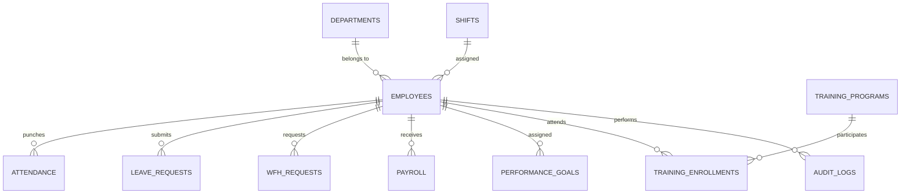

# 🗄️ VorldX Attendance 360 — Complete Database Documentation

This directory contains the production-grade, enterprise-ready database schemas, seed data, adapters, and deployment scripts for **VorldX Attendance 360** (VorldX Industries Pvt. Ltd.).

---

## 📁 Database Files Overview

| File | Database Engine | Size | Purpose |
|------|-----------------|------|---------|
| **`WorldX_Complete_Master_Setup.sql`** | Microsoft SQL Server (2019/2022/Azure) | ~50 KB | Single-script master setup: Database creation, all 12 enterprise tables, indexes, constraints, views, stored procedures, audit triggers, and comprehensive seed data. |
| **`WorldX_SQLServer_Schema.sql`** | Microsoft SQL Server | ~28 KB | Pure DDL schema: Table definitions, primary/foreign keys, check constraints, default constraints. |
| **`WorldX_SQLServer_SeedData.sql`** | Microsoft SQL Server | ~18 KB | DML seed script: Complete employees (`EMP001` - `EMP020`), departments, shifts, attendance punch records, leave applications, WFH logs, company policies, and training programs. |
| **`WorldX_SQLite_Master.sql`** | SQLite 3 | ~66 KB | Ready-to-use SQLite dump with transaction safety (`PRAGMA foreign_keys`), exact tables, and records. |
| **`SQL_SERVER_SETUP_GUIDE.md`** | Docs | ~12 KB | Comprehensive setup guide covering SSMS, Docker, Azure SQL, and connection strings. |
| **`mssql_adapter.js`** | Node.js | ~4 KB | Production Node.js MSSQL adapter with connection pooling and query abstractions. |

---

## 🚀 Quick Setup Instructions

### Option 1: Microsoft SQL Server / Azure SQL
1. Open **SQL Server Management Studio (SSMS)** or **Azure Data Studio**.
2. Connect to your SQL Server instance (e.g. `localhost` or Azure host).
3. Open [`WorldX_Complete_Master_Setup.sql`](./WorldX_Complete_Master_Setup.sql).
4. Click **Execute** (or press `F5`).
5. The `WorldX_AttendanceDB` database will be created with all tables, views, stored procedures, and test data.

### Option 2: SQLite (Instant Local Dev)
To initialize a fresh SQLite database from scratch:
```bash
# Using SQLite CLI
sqlite3 vorldx_attendance.sqlite < database/WorldX_SQLite_Master.sql
```
Or simply start the backend server (`npm run dev`), which initializes SQLite automatically via `server/db.js`.

---

## 🏛️ Schema Entity Relationship (ERD)



### Core Tables Included:
1. `departments` (Engineering, HR, Marketing, Sales, Finance, Support, IT)
2. `shifts` (General, Morning, Evening, Night, Flexible)
3. `employees` (RBAC roles: Super Admin, HR Manager, Department Lead, Staff)
4. `attendance` (Punch In, Punch Out, GPS Coordinates, Biometric mode, Late calculation, Regularization)
5. `leave_requests` (Casual, Sick, Earned, Maternity, Paternity, Bereavement)
6. `wfh_requests` (Date, Reason, Contact, Deliverables, Status, Approval audit)
7. `payroll` (Basic, HRA, Allowances, PF, TDS, Deductions, Net salary, Payment status)
8. `company_policies` (WFH, Leave, Conduct, Security, Equal Opportunity, Versioning)
9. `training_programs` (Leadership, Cybersecurity, Communication, Project Management)
10. `performance_goals` (Quarterly KPIs, Progress tracking, Review status)
11. `notices_announcements` (Company broadcast, holidays, events)
12. `audit_logs` (Security & compliance trail)

---

*VORLDX INDUSTRIES PRIVATE LIMITED — Enterprise Engineering Division*
