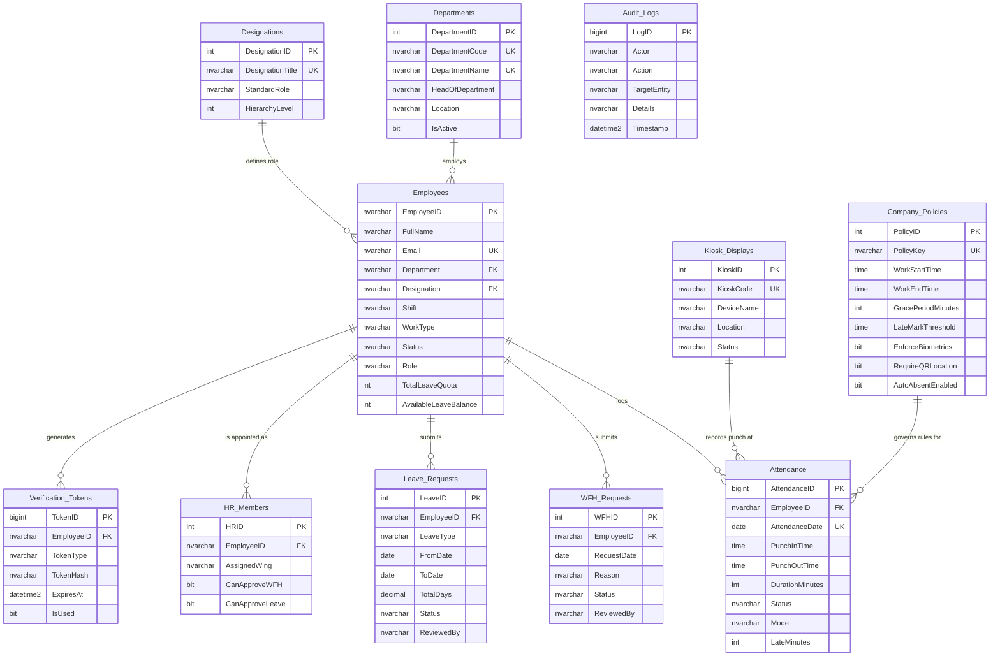

# WorldX Attendance 360 — Microsoft SQL Server Database Guide

## 1. Enterprise Database Overview

This database architecture provides a production-grade, enterprise-scale **Microsoft SQL Server (T-SQL)** implementation for the entire **WorldX Attendance 360** platform (VorldX Industries Pvt Ltd). It powers:
- **Admin Portal (7 Screens):** Dashboard KPI metrics, Employees Directory (50 roster), WFH Approvals, Leave Approvals, HR Operations & Wing Assignment, Company Policies & Timing Thresholds, Department-Wise Analytics.
- **Employee Portal (6 Screens):** Personal Dashboard, Monthly Attendance Matrix (October 2026 calendar dots), WFH Application Flow, Leave Request Management, Personal Profile & Emergency Contacts, Real-Time Notification Center.
- **Kiosks & Verification Layer:** Floor-wise QR Display Kiosks (`QR001`, `QR002`, `QR003`), WebAuthn/SSO OTP verification tokens, and compliance Audit Trail.

---

## 2. Entity Relationship Model (ER Diagram)



---

## 3. Database Files Included

All files are located in `c:\Users\shrey\OneDrive\Desktop\vorldx\database\`:

| File Name | Purpose | Recommended For |
|---|---|---|
| `WorldX_Complete_Master_Setup.sql` | **Single Master Script** that creates DB, tables, views, stored procedures, and seeds all 50 employees + records. | **One-click complete deployment** in SSMS, Azure Data Studio, or `sqlcmd`. |
| `WorldX_SQLServer_Schema.sql` | Schema-only script (12 tables, indexes, 4 views, 3 stored procedures). | Production DBAs creating fresh empty databases. |
| `WorldX_SQLServer_SeedData.sql` | Standalone seed data script (Departments, Designations, 50 Employees, Attendance, Policies, WFH, Leaves, Kiosks). | Populating existing database with demo and baseline data. |
| `mssql_adapter.js` | Production Node.js driver wrapper using `mssql` connection pooling. | Backend Node.js server integration. |

---

## 4. Setup & Execution Instructions

### Option A: Using SQL Server Management Studio (SSMS) or Azure Data Studio
1. Open **SQL Server Management Studio (SSMS)** or **Azure Data Studio**.
2. Connect to your SQL Server instance (e.g. `localhost` or `.\SQLEXPRESS`).
3. Press `Ctrl + O` and open:
   `c:\Users\shrey\OneDrive\Desktop\vorldx\database\WorldX_Complete_Master_Setup.sql`
4. Click **Execute** (or press `F5`).
5. In the Messages pane, you will see step-by-step confirmation:
   - `>> Database [WorldX_Attendance360] created successfully.`
   - `>> STEP 2: CREATING TABLES AND CONSTRAINTS`
   - `>> STEP 3: CREATING VIEWS & STORED PROCEDURES`
   - `>> STEP 4: SEEDING PRODUCTION DATA & MOCKUP DEMO ROSTER`
   - `>> [SUCCESS] WorldX Attendance 360 complete SQL Server master setup finished!`

---

### Option B: Using `sqlcmd` Command Line
From Windows PowerShell or Command Prompt:

```powershell
# Using Windows Authentication (Local Default Instance)
sqlcmd -S localhost -E -i "c:\Users\shrey\OneDrive\Desktop\vorldx\database\WorldX_Complete_Master_Setup.sql"

# Using SQL Server Authentication (e.g. sa user)
sqlcmd -S localhost -U sa -P "YourStrongPassword" -i "c:\Users\shrey\OneDrive\Desktop\vorldx\database\WorldX_Complete_Master_Setup.sql"
```

---

### Option C: Using Docker Container
If you don't have SQL Server installed locally, spin up a lightweight official Microsoft Docker container:

```bash
# 1. Run SQL Server 2022 Docker Container
docker run -e "ACCEPT_EULA=Y" -e "MSSQL_SA_PASSWORD=WorldX@2026!Secure" -p 1433:1433 --name worldx-sqlserver -d mcr.microsoft.com/mssql/server:2022-latest

# 2. Wait 10 seconds for SQL Server to boot, then execute master script
docker exec -i worldx-sqlserver /opt/mssql-tools/bin/sqlcmd -S localhost -U sa -P "WorldX@2026!Secure" < "c:\Users\shrey\OneDrive\Desktop\vorldx\database\WorldX_Complete_Master_Setup.sql"
```

---

## 5. UI Screen to Table Mapping

### Admin Portal (7 Screens)
| Screen | UI Component | Primary Tables / Views Queried |
|---|---|---|
| **1. Dashboard** | `AdminPortal.jsx` (KPIs, Charts, Activities) | `dbo.vw_AdminDashboardKPIs`, `dbo.vw_DepartmentWiseAttendance`, `dbo.vw_RecentActivities` |
| **2. Employees** | Employees table, Search, Filters, CSV Export | `dbo.Employees`, `dbo.Departments`, `dbo.Designations` |
| **3. WFH Requests** | Pending/Approved/Rejected tabs, Action buttons | `dbo.WFH_Requests`, `dbo.sp_ApproveWFHRequest` |
| **4. Leave Requests** | Casual/Sick/Earned cards, Status pill | `dbo.Leave_Requests`, `dbo.sp_ApproveLeaveRequest` |
| **5. HR Management** | HR members, Wing assignments, HR's own requests | `dbo.HR_Members`, `dbo.Employees`, `dbo.WFH_Requests` |
| **6. Company Policies**| Timings, Grace, Quota, Toggle switches | `dbo.Company_Policies` |
| **7. Reports & Analytics**| Clustered attendance bars, Monthly trends | `dbo.Attendance`, `dbo.vw_DepartmentWiseAttendance` |

### Employee Portal (6 Screens)
| Screen | UI Component | Primary Tables / Views Queried |
|---|---|---|
| **1. Dashboard** | Punch in/out widget, working hours, quick actions | `dbo.Attendance`, `dbo.sp_MarkAttendance`, `dbo.Employees` |
| **2. My Attendance** | October 2026 calendar view, status dots, day logs | `dbo.Attendance`, `dbo.vw_EmployeeMonthlyAttendanceSummary` |
| **3. WFH Requests** | Quota indicator (4 days), past requests table, apply form | `dbo.WFH_Requests`, `dbo.Company_Policies` |
| **4. Leave Requests** | Balance counter (12 days), leave type select, date pickers | `dbo.Leave_Requests`, `dbo.Employees` |
| **5. My Profile** | Sneha Verma profile, emergency contacts, password update | `dbo.Employees`, `dbo.Audit_Logs` |
| **6. Notifications** | 12 categorized alerts (Approvals, Company, Reminders) | `dbo.Announcements`, `dbo.WFH_Requests`, `dbo.Leave_Requests` |

---

## 6. Stored Procedures & Execution Examples

### A. Marking Attendance via QR Kiosk
```sql
USE [WorldX_Attendance360];

-- 1. Punch In for Neha Singh (EMP001) at Floor 2 Kiosk
EXEC dbo.sp_MarkAttendance 
    @EmployeeID = N'EMP001',
    @ActionType = N'PUNCH_IN',
    @Mode = N'QR Kiosk',
    @KioskCode = N'QR002',
    @Location = N'Lucknow HQ - 2nd Floor';

-- 2. Punch Out
EXEC dbo.sp_MarkAttendance 
    @EmployeeID = N'EMP001',
    @ActionType = N'PUNCH_OUT',
    @Mode = N'QR Kiosk',
    @KioskCode = N'QR002';
```

### B. Approving WFH Request (Auto-syncs Attendance)
```sql
USE [WorldX_Attendance360];

-- Approves WFH Request #1, sets status to 'Approved', logs audit, and creates Attendance record
EXEC dbo.sp_ApproveWFHRequest
    @WFHID = 1,
    @ReviewerName = N'Arun Mishra',
    @NewStatus = N'Approved',
    @Comment = N'Approved for remote work. Keep phone reachable.';
```

### C. Approving Leave Request (Auto-syncs Attendance across all leave days)
```sql
USE [WorldX_Attendance360];

-- Approves Leave Request #1
EXEC dbo.sp_ApproveLeaveRequest
    @LeaveID = 1,
    @ReviewerName = N'Arun Mishra',
    @NewStatus = N'Approved',
    @Comment = N'Approved. Enjoy your sister wedding.';
```

---

## 7. Node.js Backend Integration

To connect your Node.js backend (`server/`) directly to Microsoft SQL Server:

### 1. Install `mssql` npm package:
```bash
npm install mssql
```

### 2. Configure `.env` in project root:
```env
# Database Dialect: 'sqlite' or 'mssql'
DB_DIALECT=mssql

# Microsoft SQL Server Credentials
SQLSERVER_HOST=localhost
SQLSERVER_PORT=1433
SQLSERVER_USER=sa
SQLSERVER_PASSWORD=WorldX@2026!Secure
SQLSERVER_DATABASE=WorldX_Attendance360
SQLSERVER_ENCRYPT=false
SQLSERVER_TRUST_CERT=true
```

### 3. Use `mssql_adapter.js` in routes:
```javascript
const { query, executeProc } = require('../database/mssql_adapter');

// Example: Fetch Admin Dashboard KPIs
app.get('/api/admin/kpis', async (req, res) => {
  try {
    const kpis = await query('SELECT * FROM dbo.vw_AdminDashboardKPIs');
    res.json(kpis[0]);
  } catch (err) {
    res.status(500).json({ error: err.message });
  }
});

// Example: Punch in via stored procedure
app.post('/api/attendance/punch', async (req, res) => {
  try {
    const { employeeId, actionType, kioskCode } = req.body;
    const result = await executeProc('dbo.sp_MarkAttendance', {
      EmployeeID: employeeId,
      ActionType: actionType,
      KioskCode: kioskCode || 'QR001'
    });
    res.json(result.recordset[0]);
  } catch (err) {
    res.status(500).json({ error: err.message });
  }
});
```

---

## 8. Quick Verification Queries

Run these in SSMS to verify table counts and live seed data:

```sql
USE [WorldX_Attendance360];

-- 1. Check Admin KPI View
SELECT * FROM dbo.vw_AdminDashboardKPIs;
-- Expected: TotalEmployees = 50, PresentToday = 32, WfhToday = 8, OnLeaveToday = 5, AbsentToday = 5

-- 2. Check Department-wise Attendance
SELECT * FROM dbo.vw_DepartmentWiseAttendance;

-- 3. Check All Active HR Members
SELECT * FROM dbo.HR_Members;

-- 4. Check Policy Settings
SELECT PolicyName, WorkStartTime, WorkEndTime, GracePeriodMinutes, LateMarkThreshold, RequireQRLocation, AutoAbsentEnabled 
FROM dbo.Company_Policies;
```

---
**VORLDX INDUSTRIES PRIVATE LIMITED**  
*Building Virtual World with Simplicity*  
Lucknow, Uttar Pradesh, India • CIN: U62099UP2026PTC245598
